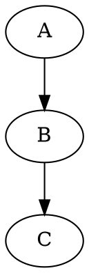
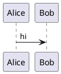

Ada, ini ronde dua. Isinya kasus pinggiran dan jebakan yang sering bikin renderer chat AI salah tampil.

## 16. Line break
Baris satu
Baris dua (cuma newline biasa, harusnya tetap di baris baru)
Baris tiga pakai dua spasi di akhir  
Baris empat

## 17. Penanda alternatif
_italic underscore_, __bold underscore__, nama_variabel_snake_case (yang ini harusnya gak jadi italic)
* list pakai bintang
+ list pakai plus

5. List mulai dari 5
6. Lanjut 6

## 18. Heading gaya setext
Heading pakai garis =
===

Heading pakai garis -
---

## 19. Jebakan dolar (ini harusnya gak jadi math)
Harganya $5 dan $10, total $15.

## 20. Variasi link
<https://nouride.com>, [reference link][ref], email: hello@example.com, link yang ada kurungnya: https://en.wikipedia.org/wiki/Fox_(disambiguation)

[ref]: https://nouride.com

## 21. Code di dalam list dan quote
1. Jalanin ini:
   ```bash
   bun install && bun test
   ```
2. Terus cek hasilnya

> ```json
> { "inside": "quote" }
> ```

## 22. Indented code block (4 spasi)

    echo "indented code"

## 23. Baris code yang panjang banget
```bash
curl -fsSL https://example.com/install.sh | bash -s -- --variant router --version v0.8.37 --data-dir /srv/nouride --port 18254 --no-start --verbose
```

## 24. Tabel lebar dan tabel dengan pipe di dalam sel
| A | B | C | D | E | F | G | H | I | J | K | L |
|---|---|---|---|---|---|---|---|---|---|---|---|
| satu | dua | tiga | empat | lima | enam | tujuh | delapan | sembilan | sepuluh | sebelas | duabelas |

| Perintah | Arti |
|---|---|
| `a \| b` | pipe yang di-escape di dalam code |
| **bold** dan [link](https://nouride.com) | format di dalam sel |

## 25. Highlight dan emoji shortcode
==teks di-highlight==, :smile: :rocket:

## 26. Unicode
CJK: 你好世界 こんにちは 안녕하세요
RTL: مرحبا بالعالم
Emoji ZWJ dan bendera: 👨‍👩‍👧 🏳️‍🌈 🇮🇩
Kombinasi aksen: é ñ ü

## 27. Komentar HTML (harusnya gak kelihatan)
Sebelum<!-- ini komentar tersembunyi -->sesudah

## 28. Definition list
Nouride
: Daemon agent multi-platform

## 29. Bahasa lain di code block
```sql
SELECT id, name FROM agents WHERE active = 1;
```

```yaml
agent: nix
model: opus
```

```jsonc
// JSON yang ada komentarnya
{ "a": 1 }
```

## 30. Diagram lain




## 31. SVG inline
<svg width="60" height="60"><circle cx="30" cy="30" r="25" fill="orange"/></svg>

---

Di luar isi pesan, ada beberapa hal yang lebih kena kalau dicoba langsung:
- **Streaming**: minta jawaban panjang yang ada tabel dan code block, terus lihat apakah tampilannya loncat-loncat pas tabel atau fence-nya belum selesai ditulis.
- **Pesan yang panjang banget**: cek scroll dan performanya.
- **HP**: buka tabel lebar dan baris code panjang di layar sempit, lihat bisa di-scroll ke samping atau malah keluar dari layar.
- **Dark mode**: warna code block, tabel, dan quote masih kebaca apa gak.
- **Copy**: tombol copy di code block, plus apa yang ke-copy kalau lu nyalin pesannya pakai seleksi biasa (markdown atau teks yang udah di-render).

Nomor 19 (dolar), 17 (snake_case), dan 27 (komentar HTML) itu jebakan. Yang benar justru kalau ketiganya **gak** berubah format.