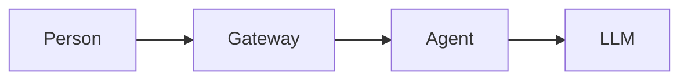

# Tes render chat

## 1. Heading
### H3
#### H4

## 2. Teks inline
**bold**, *italic*, ***bold italic***, ~~strikethrough~~, `inline code`, [link](https://nouride.com), https://nouride.com, <kbd>Ctrl</kbd>+<kbd>C</kbd>, H<sub>2</sub>O, x<sup>2</sup>, emoji 🦊🌌

## 3. List bertingkat
- Level 1
  - Level 2
    - Level 3
1. Satu
2. Dua
   1. Dua-a
   2. Dua-b

## 4. Task list
- [x] Udah
- [ ] Belum

## 5. Blockquote dan callout
> Quote biasa
>> Quote di dalam quote

> [!NOTE]
> Callout ala GitHub

> [!WARNING]
> Callout warning

## 6. Tabel dengan alignment
| Kiri | Tengah | Kanan |
|:---|:---:|---:|
| a | b | 1 |
| panjang sekali teksnya | c | 1000 |

## 7. Code block
```ts
const greet = (name: string): string => `hi ${name}`;
```

```python
def greet(name: str) -> str:
    return f"hi {name}"
```

```kotlin
fun greet(name: String) = "hi $name"
```

```diff
- old line
+ new line
```

```
tanpa bahasa
```

## 8. Math
Inline: $E = mc^2$, $\sum_{i=1}^{n} i = \frac{n(n+1)}{2}$

Block:

$$
\int_0^\infty e^{-x^2}\,dx = \frac{\sqrt{\pi}}{2}
$$

Gaya kurung: \( a^2 + b^2 = c^2 \) dan

\[
\begin{pmatrix} 1 & 0 \\ 0 & 1 \end{pmatrix}
\]

## 9. Mermaid


## 10. Gambar


## 11. Footnote
Kalimat ini punya catatan kaki[^1].

[^1]: Ini isi catatan kakinya.

## 12. HTML collapsible
<details>
<summary>Klik buat buka</summary>

Isi yang tersembunyi.
</details>

## 13. Garis horizontal
---

## 14. Teks panjang tanpa spasi
a3f9c2e8b7d14f6a9e0c5b2d8f1a7e4c3b9d6f2a8e5c1b7d4f0a3e9c6b2d8f5a1e7c4b0d3f9a6e2c8b5d1f7a4e0c3b9d6f2a8e5c1

## 15. Karakter di-escape
\*bukan italic\*, \`bukan code\`, 1\. bukan list

---

Lu tinggal bilang nomor mana yang tampil mentah atau rusak. Yang gw kirim di sini sintaks standar yang biasanya di-render sama ChatGPT, Claude.ai, sama GitHub.